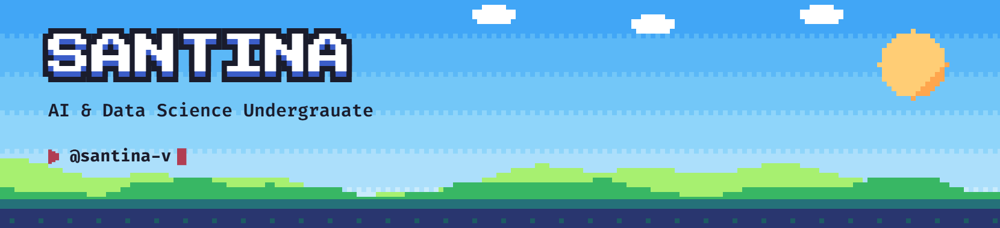

<!-- ========================================================= -->
<!--                    PROFILE HEADER                          -->
<!-- ========================================================= -->

<picture>
  <source media="(prefers-color-scheme: dark)" srcset="art/header-dark.png">
  <source media="(prefers-color-scheme: light)" srcset="art/header-light.png">
  
</picture>

 

<!-- ========================================================= -->
<!--                      INTRO                                 -->
<!-- ========================================================= -->

# Hey there, I'm Santina 👋

  

 

---

<!-- ========================================================= -->
<!--                      ABOUT ME                              -->
<!-- ========================================================= -->

<h2 align="center">🌸 About Me</h2>

<table align="center">
<tr>
<td width="65%" valign="middle">

### Hi, I'm Santina 💗

🎓 I'm a AI & Data Science student at Sri Krishna College of Engineering and Technology.

💻 I'm passionate about **Data Analytics, Artificial Intelligence, Machine Learning, and Software Development**.

📊 I enjoy transforming raw data into **meaningful insights, visualizations, and intelligent solutions**.

🌱 Currently learning:

- **[SKILL / TECHNOLOGY 1]**
- **[SKILL / TECHNOLOGY 2]**
- **[SKILL / TECHNOLOGY 3]**

💡 I love building projects, solving problems, participating in hackathons, and continuously learning new technologies.

</td>

<td width="35%" align="center">

  

</td>
</tr>
</table>

 

---

<!-- ========================================================= -->
<!--                      TECH STACK                            -->
<!-- ========================================================= -->

<h2 align="center">🛠️ Tech Stack</h2>

### 👩‍💻 Programming Languages

  

### 📊 Data Science & AI

  

### 🌐 Web Development

  

### 🗄️ Databases & Cloud

  

### ⚙️ Tools & Platforms

 

---

<!-- ========================================================= -->
<!--                   GITHUB ANALYTICS                         -->
<!-- ========================================================= -->

<h2 align="center">📊 GitHub Analytics</h2>

 

---

<!-- ========================================================= -->
<!--                    GITHUB STREAK                           -->
<!-- ========================================================= -->

<h2 align="center">🔥 GitHub Streak</h2>

 

---

<!-- ========================================================= -->
<!--                 CONTRIBUTION ACTIVITY                     -->
<!-- ========================================================= -->

<h2 align="center">📈 Contribution Activity</h2>

 

---

<!-- ========================================================= -->
<!--                   CONTRIBUTION SNAKE                       -->
<!-- ========================================================= -->

<h2 align="center">🐍 Contribution Snake</h2>

<!--
==============================================================
GITHUB ACTION SETUP
==============================================================

Create:

.github/workflows/snake.yml

Then add the following GitHub Action:

name: Generate Contribution Snake

on:
  schedule:
    - cron: "0 0 * * *"
  workflow_dispatch:

jobs:
  generate:
    runs-on: ubuntu-latest

    steps:
      - uses: Platane/snk@v3
        with:
          github_user_name: ${{ github.repository_owner }}
          outputs: |
            dist/github-contribution-grid-snake.svg
            dist/github-contribution-grid-snake-dark.svg?palette=github-dark

      - uses: crazy-max/ghaction-github-pages@v4
        with:
          build_dir: dist
        env:
          GH_PAT: ${{ secrets.GH_PAT }}

==============================================================
-->

  <picture>
    <source
      media="(prefers-color-scheme: dark)"
      srcset="https://raw.githubusercontent.com/santina-v/santina-v/main/assets/github-contribution-grid-snake-dark.svg">
    <source
      media="(prefers-color-scheme: light)"
      srcset="https://raw.githubusercontent.com/santina-v/santina-v/main/assets/github-contribution-grid-snake.svg">
    
  </picture>

 

---

<!-- ========================================================= -->
<!--                    FEATURED PROJECTS                       -->
<!-- ========================================================= -->

<h2 align="center">💻 Featured Projects</h2>

<table>
<tr>

<td width="50%" valign="top">

<h3 align="center">
  🛡️ InsurGuard AI
</h3>

  

  AI-powered insurance fraud detection and investigation platform that analyzes claims, documents, and evidence to identify inconsistencies and generate explainable fraud risk insights.

</td>

<td width="50%" valign="top">

<h3 align="center">
  📌 KnotBoard
</h3>

  

  A full-stack collaborative project management application built with Node.js and Spring Boot.

</td>

</tr>

<tr>

<td width="50%" valign="top">

<h3 align="center">
  🤖 NEXUS AI
</h3>

  

  Offline intelligent desktop AI assistant with local LLMs, document analysis, automation, web augmentation, and real-time system monitoring.

</td>

<td width="50%" valign="top">

<h3 align="center">
  📊 Data Analytics
</h3>

  <b>More projects coming soon...</b> 
  Building data-driven solutions with Python, SQL, statistics, visualization and machine learning.

</td>

</tr>
</table>

 

<!-- ========================================================= -->
<!--                     CONNECT                                -->
<!-- ========================================================= -->

<h2 align="center">🌷 Connect With Me</h2>

 

---

<!-- ========================================================= -->
<!--                         FOOTER                              -->
<!-- ========================================================= -->

 

### 💗 Thanks for visiting my profile!

  

Santina V 

